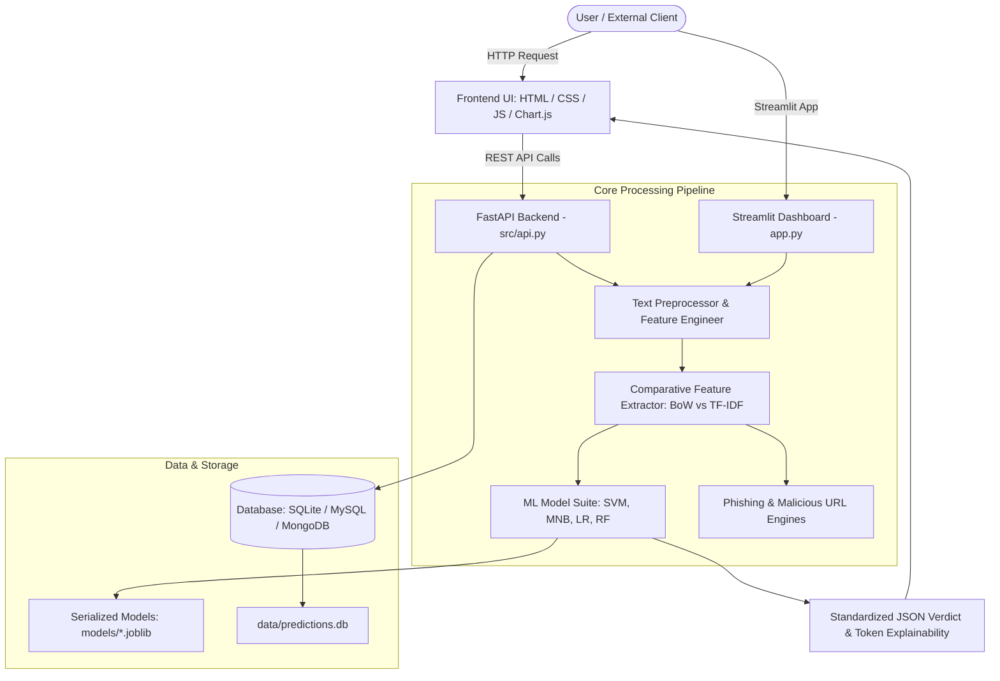

# 🛡️ AI Email & SMS Spam, Phishing and Malicious Threat Detection System

[](https://www.python.org/)
[](https://fastapi.tiangolo.com)
[](https://scikit-learn.org/)
[](https://opensource.org/licenses/MIT)

An end-to-end Machine Learning, NLP, and Cyber Threat Detection system for real-time classification of **SMS Spam**, **Email Spam (Subject + Body)**, **Phishing Attacks**, and **Malicious URLs**.

Includes a core empirical benchmark comparing **Bag-of-Words (BoW)** vs. **Term Frequency - Inverse Document Frequency (TF-IDF)** across 5 machine learning architectures, backed by a **FastAPI REST API**, **SQLite Database**, and an interactive **HTML/CSS/JS web dashboard** with real-time token explainability.

---

## 🏗️ 1. System Architecture



---

## 📂 2. Repository Structure

```
spam-detector/
├── backend/                  # Standalone backend server entry point
│   └── main.py
├── data/                     # Raw datasets and persistent databases
│   ├── raw/                  # Downloaded raw datasets (UCI SMS, SpamAssassin)
│   └── predictions.db        # SQLite database logging all threat evaluations
├── database/                 # Database abstraction and CRUD logic
│   └── db.py
├── frontend/                 # Standalone responsive web client
│   ├── index.html            # Dark/light UI with SMS, Email, Phishing, URL, Dashboard tabs
│   ├── style.css             # Modern clean styling with color-coded result cards
│   └── app.js                # Chart.js analytics, real-time prediction & search filter
├── models/                   # Serialized vectorizers & trained ML models (.joblib)
│   ├── bow_vectorizer.joblib
│   ├── tfidf_vectorizer.joblib
│   ├── bow_*.joblib
│   └── tfidf_*.joblib
├── notebooks/                # End-to-end reproducible experiment notebook
│   └── end_to_end_experiment.ipynb
├── reports/                  # Evaluation benchmarks, charts & reports
│   ├── evaluation_comparison_table.csv
│   ├── metrics_summary.csv
│   ├── bow_vs_tfidf_comparison_bars.png
│   ├── roc_curves_comparison.png
│   ├── model_recommendation_report.md
│   ├── project_report_outline.md
│   └── viva_questions_and_answers.md
├── src/                      # Modular Python source code
│   ├── __init__.py
│   ├── dataset.py            # Multi-dataset loader & registry
│   ├── preprocess.py         # Text cleaning, stemming, extra features, 70/15/15 split
│   ├── feature_extraction.py # Comparative BoW and TF-IDF extraction & grid tuning
│   ├── train_ml.py           # GridSearchCV training pipeline across 5 ML models
│   ├── evaluate.py           # Comprehensive evaluation, latency timing, ROC generation
│   ├── advanced_detectors.py # Phishing heuristics & URL character n-gram detector
│   ├── predict.py            # Unified prediction engine & token attribution
│   ├── database.py           # Persistence manager reading from .env
│   └── api.py                # FastAPI application with CORS and 8 endpoints
├── static/                   # Static web assets served by FastAPI
│   ├── index.html
│   ├── style.css
│   └── app.js
├── tests/                    # Automated test suites
│   ├── test_pipeline.py      # Unit tests for text normalization
│   └── test_suite.py         # Complete unit and API endpoint test suite
├── .env                      # Database & server environment variables
├── .env.example              # Environment variables template
├── app.py                    # Streamlit web application dashboard
├── download_data.py          # Automated dataset downloader
├── requirements.txt          # Python dependencies with pinned versions
└── README.md                 # Project documentation
```

---

## 🏆 3. Empirical Results: BoW vs. TF-IDF Leaderboard

Evaluation results on the **held-out test split** (15% untouched test set: 837 samples, 112 Spam, 725 Ham):

| Representation | Model Architecture | Accuracy | Precision (Spam) | Recall (Spam) | $F_1$-Score | ROC-AUC | Latency / Sample |
| :---: | :--- | :---: | :---: | :---: | :---: | :---: | :---: |
| **TF-IDF** | **SVM (RBF Kernel)** 🥇 | **98.57%** | **98.08%** | **91.07%** | **0.9444** | **0.9883** | 0.1236 ms |
| **BoW** | **Multinomial Naive Bayes** | 98.45% | 98.06% | 90.18% | 0.9395 | 0.9731 | 0.0010 ms |
| **BoW** | **Logistic Regression** | 98.45% | 98.06% | 90.18% | 0.9395 | 0.9889 | 0.0004 ms |
| **BoW** | **Linear SVM** | 98.45% | 98.06% | 90.18% | 0.9395 | 0.9885 | 0.0003 ms |
| **TF-IDF** | **Linear SVM** | 98.45% | 98.06% | 90.18% | 0.9395 | 0.9874 | 0.0004 ms |
| **TF-IDF** | **Multinomial Naive Bayes** | 98.33% | 98.04% | 89.29% | 0.9346 | 0.9886 | 0.0004 ms |
| **BoW** | **SVM (RBF Kernel)** | 98.33% | **100.00%** | 87.50% | 0.9333 | 0.9848 | 0.1127 ms |
| **TF-IDF** | **Logistic Regression** | 98.21% | 93.69% | **92.86%** | 0.9327 | 0.9851 | 0.0006 ms |
| **BoW** | **Random Forest** | 97.85% | **100.00%** | 83.93% | 0.9126 | **0.9932** | 0.0949 ms |
| **TF-IDF** | **Random Forest** | 97.85% | **100.00%** | 83.93% | 0.9126 | 0.9919 | 0.0748 ms |

---

## 📸 4. Screenshots & Visual Artifacts

Generated charts in [`reports/`](reports/):
- **BoW vs. TF-IDF Multi-Metric Comparison Grid**: `reports/bow_vs_tfidf_comparison_bars.png`
- **Comparative ROC Curves**: `reports/roc_curves_comparison.png`
- **Exploratory Data Analysis (EDA) Word Clouds**: `reports/eda_wordclouds.png`
- **Top 20 Frequent Spam Keywords**: `reports/eda_top_spam_words.png`
- **Message Length Distribution**: `reports/eda_message_length_distribution.png`

---

## ⚡ 5. Quickstart & Installation

### Step 1: Environment Setup
```powershell
# Clone repository and enter directory
cd "Email and SMS Spam Detection ML Project"

# Create and activate virtual environment
python -m venv .venv
.\.venv\Scripts\activate       # Windows
# source .venv/bin/activate    # Linux / macOS

# Install dependencies
pip install -r requirements.txt
```

### Step 2: Download Data & Train Models
```powershell
# Download benchmark dataset
python download_data.py --sms

# Train all models with 5-fold cross-validation
python src/train_ml.py --dataset sms

# Run complete evaluation benchmark
python src/evaluate.py --dataset sms
```

### Step 3: Run Unit & API Tests
```powershell
python -m unittest tests/test_suite.py
```

### Step 4: Launch Web Dashboard & REST API
```powershell
# Option A: Run FastAPI + HTML/JS Frontend (Recommended)
uvicorn src.api:app --host 0.0.0.0 --port 8000 --reload
# Access web app at http://localhost:8000/
# Access interactive Swagger docs at http://localhost:8000/docs

# Option B: Run Streamlit Analytics Dashboard
streamlit run app.py
# Access dashboard at http://localhost:8501
```

---

## 📌 6. Important Library Versions

| Package | Version Tested |
| :--- | :---: |
| **Python** | `3.12.10` |
| **scikit-learn** | `1.9.1` |
| **pandas** | `3.1.0` |
| **numpy** | `2.5.4` |
| **fastapi** | `0.162.0` |
| **uvicorn** | `0.54.0` |
| **pydantic** | `2.14.2` |
| **nltk** | `3.10.4` |
| **streamlit** | `1.66.1` |
| **joblib** | `1.6.0` |
| **python-dotenv** | `1.2.4` |
