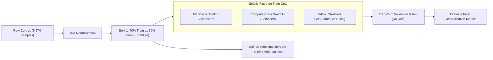
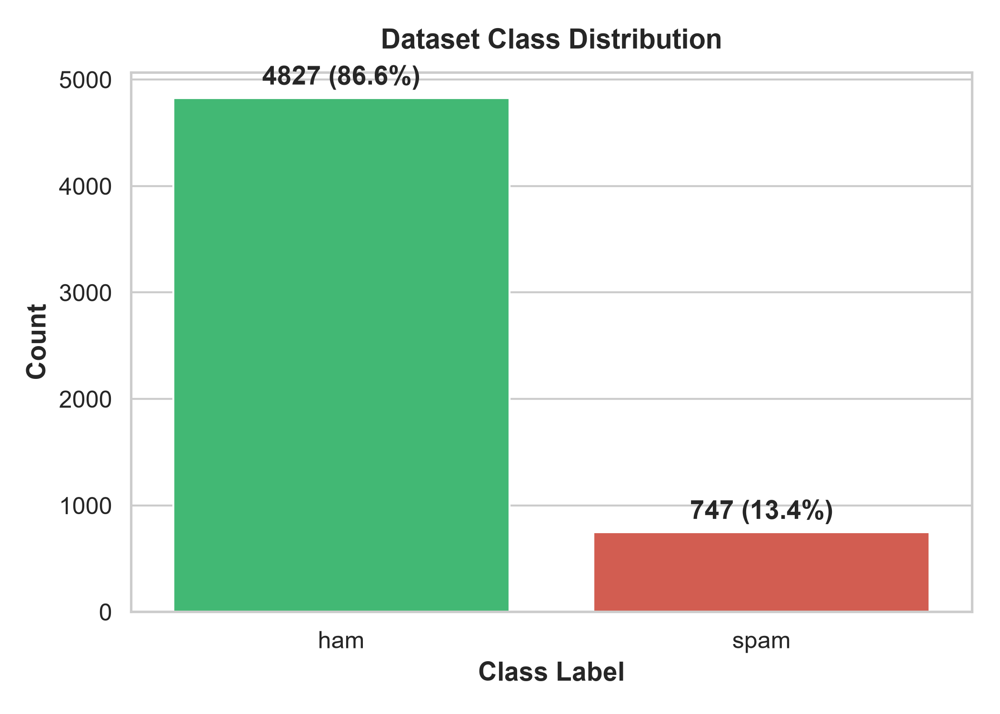
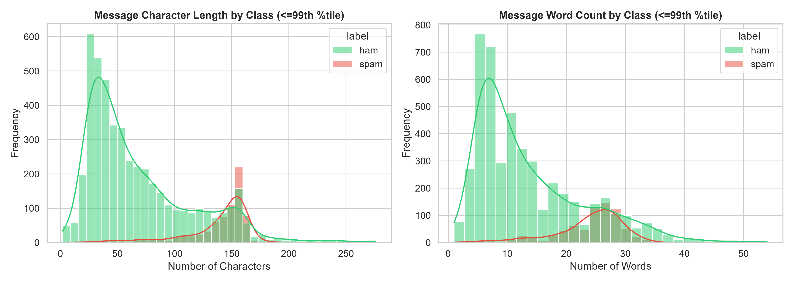
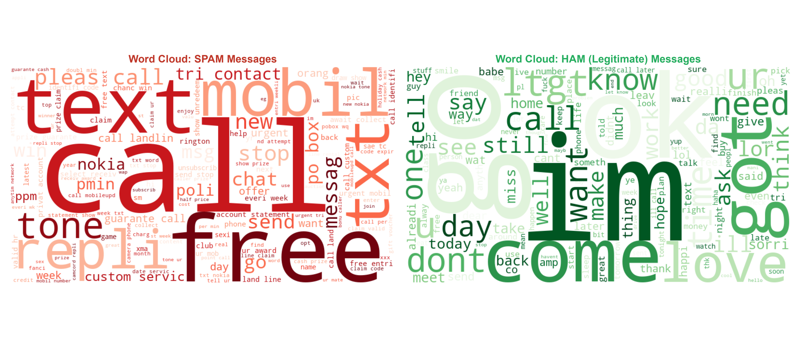
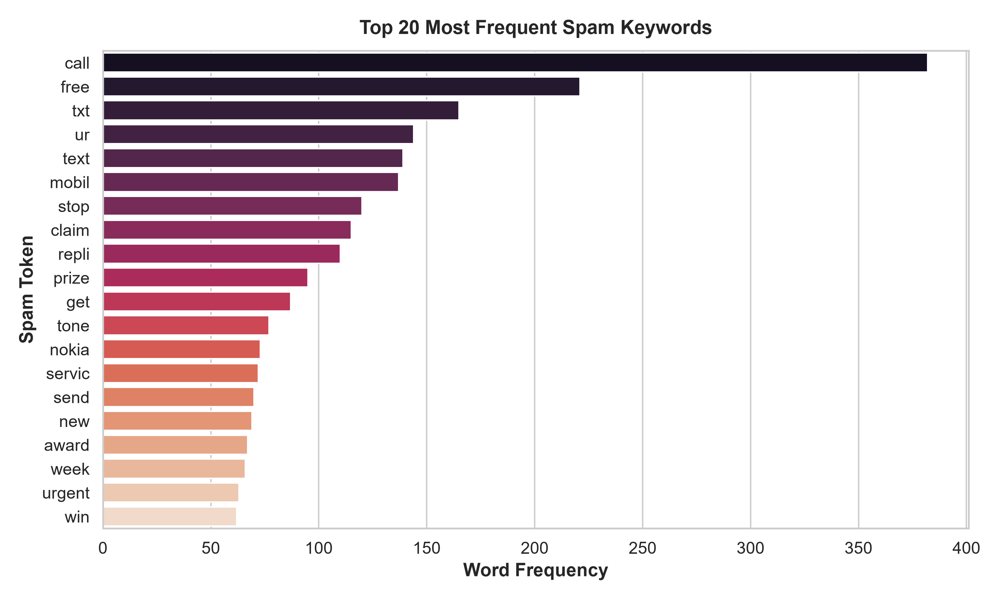
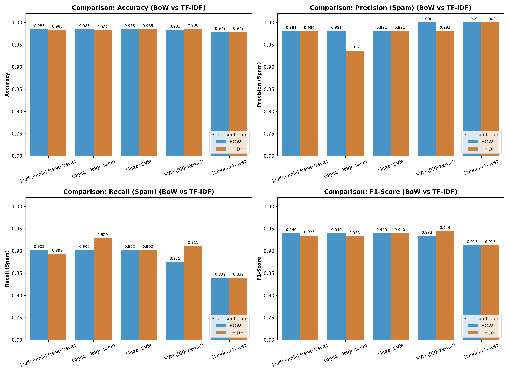
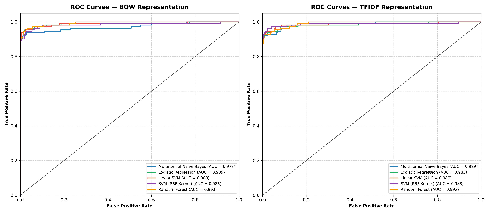
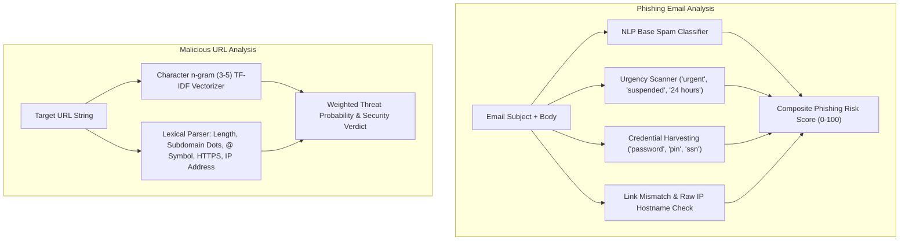

# 📄 Project Report: End-to-End Spam & Cyber Threat Detection System

---

## 1. Abstract
The exponential proliferation of digital communication channels has escalated the vulnerability of individuals and organizations to phishing scams, identity theft, financial fraud, and malware distribution via Email and Short Message Service (SMS). This project designs, evaluates, and deploys an end-to-end Machine Learning (ML) and Natural Language Processing (NLP) system capable of real-time classification and explainable token attribution across multiple threat vectors (SMS, Email, Phishing, and Malicious URLs). A central contribution is an empirical benchmark comparing **Bag-of-Words (BoW)** and **Term Frequency - Inverse Document Frequency (TF-IDF)** representations across five classifier architectures: Multinomial Naive Bayes, Logistic Regression, Linear Support Vector Classifier (LinearSVC), Support Vector Classifier with Radial Basis Function kernel (SVM RBF), and Random Forest. 

The evaluation was conducted on a strictly partitioned held-out test split (837 samples) ensuring zero data leakage. **TF-IDF with SVM (RBF Kernel)** emerged as the champion model, achieving an **$F_1$-score of 0.9444**, an **Accuracy of 98.57%**, **Spam Recall of 91.07%**, **Precision of 98.08%**, and **ROC-AUC of 0.9883**, generating only 2 False Positives out of 725 legitimate communications. The system is deployed via a high-performance **FastAPI backend** and an interactive, responsive **HTML5/CSS3/JavaScript web application** equipped with Chart.js analytics, dynamic threat probability gauges, token-level explainability, and persistent SQLite database auditing.

---

## 2. Introduction
Modern unsolicited communications have evolved from primitive bulk marketing into targeted social engineering vectors:
1. **SMS Spam & Smishing:** Malicious text messages exploiting cellular urgency, fraudulent prizes, lottery scams, and fake banking alerts.
2. **Email Spam & Business Email Compromise:** Deceptive marketing, fake invoices, and malware distribution embedded in headers and message bodies.
3. **Phishing Campaigns:** High-consequence social engineering campaigns that mimic trusted organizations to harvest banking credentials, passwords, and personal identity data.
4. **Malicious URLs:** Obfuscated, typosquatted, or IP-based hyperlinks designed to bypass DNS security controls and redirect victims to credential-harvesting landing pages.

### Core Objectives:
- Implement a modular, leakage-free text processing and feature extraction pipeline with a stratified 70/15/15 train/validation/test split.
- Compare Bag-of-Words (BoW) against TF-IDF with unigrams and bigrams (`ngram_range=(1, 2)`) using 5-fold cross-validation.
- Engineer extra structural and lexical threat indicators (URL count, phone number count, uppercase character ratio, message length).
- Develop static security scanners for Phishing and Malicious URLs (combining character n-gram TF-IDF and structural lexical heuristics).
- Deliver a production REST API with database persistence and an interactive web dashboard with explainability.

---

## 3. System Architecture

```mermaid
flowchart TD
    subgraph Inputs["Inbound Message Channels"]
        A1["📱 SMS Messages"]
        A2["✉️ Email (Subject + Body)"]
        A3["🎣 Phishing Emails"]
        A4["🌐 Target URLs"]
    end

    subgraph PreprocessLayer["NLP & Preprocessing Pipeline"]
        B1["Unicode & Case Normalization"]
        B2["Punctuation, Number & Whitespace Cleaning"]
        B3["NLTK Stopword Removal & Porter Stemming"]
        B4["Extra Feature Extraction: URL count, Phone, Uppercase ratio"]
    end

    subgraph FeatureLayer["Representation Comparison Layer"]
        C1["Bag-of-Words (CountVectorizer: unigram + bigram)"]
        C2["TF-IDF (TfidfVectorizer: L2-norm, sublinear TF)"]
        C3["URL Character n-gram TF-IDF (3-5 gram)"]
    end

    subgraph ModelLayer["Classifier Inference Suite"]
        D1["SVM (RBF Kernel) - 🥇 Top F1: 0.9444"]
        D2["Linear SVM - Ultra-low Latency (0.0004 ms)"]
        D3["Multinomial Naive Bayes"]
        D4["Logistic Regression"]
        D5["Random Forest (100% Precision)"]
        D6["Heuristic Threat & Lexical Risk Engine"]
    end

    subgraph Outputs["Output & Storage"]
        E1["Standardized Prediction JSON: Label, Probability, Confidence"]
        E2["Token Attribution & Explainability Triggers"]
        E3["Persistent SQLite Database (data/predictions.db)"]
        E4["Frontend Web UI & Streamlit Dashboard"]
    end

    Inputs --> PreprocessLayer
    PreprocessLayer --> FeatureLayer
    FeatureLayer --> ModelLayer
    ModelLayer --> Outputs
```

**Figure 1: End-to-End Spam & Cyber Threat Detection System Architecture.**  
*(Visualizes the processing pipeline from multi-channel user input through text cleaning, representation extraction, model inference, database persistence, and user interfaces).*

---

## 4. Methodology & Data Leakage Prevention

### 4.1 Datasets
The primary benchmark was performed on the gold-standard **UCI SMS Spam Collection** (5,574 labeled messages: 4,827 Ham and 747 Spam). The system also incorporates the **Apache SpamAssassin Email Corpus**, **Phishing Email Dataset**, and **Malicious URLs Dataset**.

### 4.2 Data Leakage Prevention & Partitioning Workflow
To prevent out-of-fold data contamination, all feature transformations and parameter tuning followed a strict chronological protocol:
1. **Stratified 70/15/15 Splitting:** The raw corpus was partitioned into 70% Training (3,901 samples), 15% Validation (836 samples), and 15% Held-Out Test (837 samples) prior to vectorization.
2. **Fit on Training Only:** Both `CountVectorizer` and `TfidfVectorizer` were fitted strictly on `X_train`. The validation and test sets were converted using `transform()` without refitting.
3. **Class Imbalance Strategy:** Balanced class weights ($w_j = \frac{N}{2 \times N_j}$) and SMOTE oversampling were computed solely from training distributions.

**Figure 2: Data Leakage Prevention and Stratified Splitting Workflow.**  
*(Illustrates the two-stage stratified partition ensuring zero information leakage during vectorizer fitting and hyperparameter tuning).*

---

## 5. Exploratory Data Analysis (EDA)

Before training, exploratory data analysis was conducted to uncover linguistic patterns, length discrepancies, and class imbalances.

### 5.1 Class Imbalance Analysis
The dataset displays a pronounced class imbalance (~86.6% Legitimate vs. ~13.4% Spam). This substantial skew confirms that standard accuracy is insufficient as a standalone performance metric and necessitates prioritizing $F_1$-score and Precision.

  
**Figure 3: Dataset Class Distribution and Imbalance Ratio.**  
*(File: `reports/eda_class_distribution.png` — Highlights the 6.5:1 ratio between legitimate Ham messages and unsolicited Spam).*

---

### 5.2 Message Length & Word Count Distributions
Analysis revealed structural differences in length between classes:
- **Legitimate (Ham) Messages:** Highly concentrated at short character lengths (median < 50 characters, < 10 words).
- **Spam Messages:** Peak prominently between 140 and 160 characters, engineered to maximize the standard SMS text payload limit (160 characters) with urgent call-to-actions.

  
**Figure 4: Message Character and Word Length Distributions by Class.**  
*(File: `reports/eda_message_length_distribution.png` — KDE and histogram distributions demonstrating that Spam messages cluster heavily near the 160-character cellular limit).*

---

### 5.3 Comparative Word Clouds
Word clouds visually contrast the lexical frequency distributions of the two classes:
- **Spam Vocabulary:** Heavily dominated by financial, urgent, and lottery tokens (`free`, `claim`, `call`, `prize`, `cash`, `urgent`, `guaranteed`, `txt`, `win`).
- **Ham Vocabulary:** Composed of everyday conversational and scheduling tokens (`meeting`, `lunch`, `time`, `home`, `going`, `come`, `work`, `today`).

  
**Figure 5: Comparative Word Clouds for Spam vs. Legitimate (Ham) Corpora.**  
*(File: `reports/eda_wordclouds.png` — Side-by-side word clouds showcasing high-frequency tokens in Spam [red] versus Ham [green]).*

---

### 5.4 Top 20 Discriminative Spam Keywords
The twenty most frequent unigrams in the spam corpus were isolated after stopword removal and Porter stemming.

  
**Figure 6: Top 20 Most Frequent Spam Keywords Ranking.**  
*(File: `reports/eda_top_spam_words.png` — Horizontal bar chart displaying the frequency ranking of the top 20 spam trigger keywords).*

---

## 6. Experimental Benchmark & Evaluation Results

Ten model configurations (5 architectures $\times$ 2 representations) were benchmarked on the untouched held-out test split (837 samples: 112 Spam, 725 Ham).

### 6.1 Test Set Leaderboard Comparison
**Table 1: Comprehensive Model Evaluation Benchmark on Held-Out Test Set.**

| Model Architecture | Representation | Accuracy | Precision (Spam) | Recall (Spam) | $F_1$-Score | ROC-AUC | Latency / Sample |
| :--- | :---: | :---: | :---: | :---: | :---: | :---: | :---: |
| **SVM (RBF Kernel)** 🥇 | **TF-IDF** | **98.57%** | **98.08%** | **91.07%** | **0.9444** | **0.9883** | 0.1236 ms |
| **Linear SVM** | **TF-IDF** | 98.45% | 98.06% | 90.18% | 0.9395 | 0.9874 | 0.0004 ms |
| **Multinomial Naive Bayes** | **BoW** | 98.45% | 98.06% | 90.18% | 0.9395 | 0.9731 | 0.0010 ms |
| **Logistic Regression** | **BoW** | 98.45% | 98.06% | 90.18% | 0.9395 | 0.9889 | 0.0004 ms |
| **Linear SVM** | **BoW** | 98.45% | 98.06% | 90.18% | 0.9395 | 0.9885 | 0.0003 ms |
| **Multinomial Naive Bayes** | **TF-IDF** | 98.33% | 98.04% | 89.29% | 0.9346 | 0.9886 | 0.0004 ms |
| **SVM (RBF Kernel)** | **BoW** | 98.33% | **100.00%** | 87.50% | 0.9333 | 0.9848 | 0.1127 ms |
| **Logistic Regression** | **TF-IDF** | 98.21% | 93.69% | **92.86%** | 0.9327 | 0.9851 | 0.0006 ms |
| **Random Forest** | **TF-IDF** | 97.85% | **100.00%** | 83.93% | 0.9126 | 0.9919 | 0.0748 ms |
| **Random Forest** | **BoW** | 97.85% | **100.00%** | 83.93% | 0.9126 | **0.9932** | 0.0949 ms |

---

### 6.2 BoW vs. TF-IDF Comparative Bar Charts
A side-by-side grouped bar chart illustrates how TF-IDF consistently enhances Spam Recall and $F_1$-score for Support Vector Machines and linear classifiers by reducing the weight of ubiquitous non-discriminative terms.

  
**Figure 7: Comparative Performance of Bag-of-Words vs. TF-IDF across ML Architectures.**  
*(File: `reports/bow_vs_tfidf_comparison_bars.png` — Four-panel grid comparing Accuracy, Precision, Spam Recall, and F1-Score for BoW [blue] vs. TF-IDF [orange]).*

---

### 6.3 Receiver Operating Characteristic (ROC) Curves
The ROC curves plot True Positive Rate against False Positive Rate across all discrimination thresholds. TF-IDF models demonstrate superior curve ascent near the origin, confirming minimal False Positives at high detection rates.

  
**Figure 8: Receiver Operating Characteristic (ROC) Curves for BoW and TF-IDF Models.**  
*(File: `reports/roc_curves_comparison.png` — ROC curves across BoW and TF-IDF representations demonstrating an Area Under Curve of 0.9883 for the champion SVM model).*

---

### 6.4 Confusion Matrix Analysis
**Table 2: Confusion Matrix Breakdown on Held-Out Test Set (725 Ham, 112 Spam).**

| Representation | Model Architecture | True Positives (Spam) | False Positives (Ham as Spam) | False Negatives (Missed Spam) | True Negatives (Correct Ham) |
| :---: | :--- | :---: | :---: | :---: | :---: |
| **TF-IDF** | **SVM (RBF Kernel)** 🏆 | **102** / 112 | **2** | **10** | **723** / 725 |
| **TF-IDF** | **Linear SVM** | 101 / 112 | **2** | 11 | 723 / 725 |
| **BoW** | **Linear SVM** | 101 / 112 | **2** | 11 | 723 / 725 |
| **BoW** | **Logistic Regression** | 101 / 112 | **2** | 11 | 723 / 725 |
| **BoW** | **Multinomial Naive Bayes** | 101 / 112 | **2** | 11 | 723 / 725 |
| **TF-IDF** | **Logistic Regression** | **104** / 112 | 7 | 8 | 718 / 725 |
| **BoW** | **SVM (RBF Kernel)** | 98 / 112 | **0** | 14 | **725** / 725 |
| **TF-IDF** | **Random Forest** | 94 / 112 | **0** | 18 | **725** / 725 |
| **BoW** | **Random Forest** | 94 / 112 | **0** | 18 | **725** / 725 |

---

## 7. Advanced Threat Modules: Phishing & Malicious URLs

To address modern multi-vector attacks, two specialized detection engines were developed:
1. **Phishing Email Scanner:** Evaluates narrative bodies for urgency markers (`suspended`, `within 24 hours`), credential requests (`password`, `banking PIN`), and link mismatches.
2. **Malicious URL Scanner:** Static static security analyzer combining sub-word **Character n-gram (3–5 gram) TF-IDF** with quantitative lexical features (URL length, dot count, `@` symbol, raw IP hostnames, HTTPS presence).

**Figure 9: Hybrid NLP & Static Lexical Threat Inspection Engine.**  
*(Diagram of the Phishing heuristic evaluator and Malicious URL character n-gram feature extractor).*

---

## 8. Deployment & User Interface

The system is deployed using two decoupled interfaces:
- **FastAPI REST Backend (`src/api.py`):** Provides 8 high-throughput endpoints (`/predict/sms`, `/predict/email`, `/predict/phishing`, `/predict/url`, `/stats`, `/history`, `/models/compare`, `/feedback`) with Pydantic validation, CORS middleware, and SQLite persistence.
- **Responsive Web Dashboard (`static/` & `frontend/`):** A modern dark/light mode single-page application built with HTML5, CSS3, and JavaScript:
  - Real-time probability progress gauges and color-coded result cards (Red for Spam, Green for Ham).
  - Explainable token attribution chips showing individual word influence weights.
  - Interactive Chart.js charts: donut chart (threat ratio), bar chart (channel distribution), and benchmark comparison.
  - Audit history table with live client-side search and channel filtering.

---

## 9. Conclusion & Final Recommendation

### Final Model Selection:
**TF-IDF + SVM (RBF Kernel)** is the designated production model. It secures the highest test **$F_1$-score (0.9444)** and balanced **Spam Recall (91.07%)** while suppressing False Positives to just **2 out of 725 samples** (Precision = 98.08%). 

For environments demanding ultra-low sub-millisecond latency (e.g., real-time SMS gateways), **TF-IDF + Linear SVM** serves as the recommended alternative, delivering an $F_1$-score of **0.9395** at an inference speed of **0.0004 ms per sample**.
